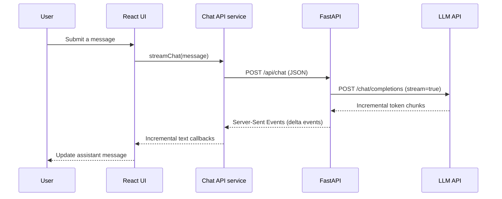

# AI Developer Knowledge Assistant

Milestone 1 is a small, understandable chat application: React and TypeScript send a message to FastAPI, FastAPI calls Gemini through its OpenAI-compatible chat-completions API, and the answer streams back to the browser. No RAG, database, repository indexing, authentication, or agent framework is included yet.

## Architecture



## Important decisions

- **Provider calls stay on the backend.** The browser never receives the LLM credential. The backend reads it from its environment and sends it in the provider's `Authorization` header.
- **Gemini is the default model provider.** The backend uses Gemini's OpenAI-compatible HTTP endpoint, so its small `httpx` implementation can keep the chat-completions request and stream protocol visible without a framework hiding it. `LLM_BASE_URL` and `LLM_MODEL` remain configurable.
- **The backend translates provider chunks to SSE.** The frontend consumes stable `{type: "delta" | "done" | "error"}` events instead of depending on a vendor-specific stream shape.
- **The UI and transport are separate.** `src/services/chatApi.ts` owns the HTTP request and stream parsing. `App.tsx` manages presentation and chat state only.
- **No answer persistence yet.** The first milestone focuses on the complete request flow. Storage belongs in a later step.
- **Conversation context is not sent yet.** Earlier turns remain visible in the browser, but each provider request includes only the current user message.

## Learning prompt

- [Prompt 1: Foundation and AI Chat](docs/prompt-1-foundation-ai-chat.md)
- [Implementation walkthrough](docs/implementation-walkthrough.md)

## Requirements

- Node.js 20.19+ or 22.12+ and npm (required by Vite 8)
- Python 3.10+
- A Gemini API key from Google AI Studio (API availability and free-tier quotas depend on Google's current terms)

## Configure and run

Open two terminals from the project root.

### Backend

PowerShell:

```powershell
cd backend
py -3 -m venv .venv
.\.venv\Scripts\Activate.ps1
python -m pip install -r requirements.txt
Copy-Item .env.example .env
# Set LLM_API_KEY in backend/.env to your Gemini API key
uvicorn app.main:app --reload --port 8000
```

The API is at `http://localhost:8000`; interactive API docs are at `http://localhost:8000/docs`.

### Frontend

From the project root:

```powershell
npm install
Copy-Item frontend/.env.example frontend/.env
npm run dev
```

Vite prints the local URL (normally `http://localhost:5173`). `VITE_API_URL` can point at another backend URL if needed.
The root npm workspace manages the frontend package; use `npm run build` to build it from the project root.

### Environment variables

Backend settings are in `backend/.env`:

| Variable | Purpose |
| --- | --- |
| `LLM_API_KEY` | Provider secret; required for chat and never sent to the browser |
| `LLM_BASE_URL` | Gemini OpenAI-compatible API root, default `https://generativelanguage.googleapis.com/v1beta/openai` |
| `LLM_MODEL` | Gemini model name, default `gemini-2.5-flash` |
| `CORS_ORIGINS` | Comma-separated browser origins allowed to call the API |

Frontend settings are in `frontend/.env`:

| Variable | Purpose |
| --- | --- |
| `VITE_API_URL` | FastAPI origin, default `http://localhost:8000` |

Only put public configuration in frontend environment variables. Anything prefixed with `VITE_` is included in browser code.

## Request flow

1. The user submits text in the chat form. React appends the user message and an empty assistant message, then calls `streamChat` from the API service.
2. The service sends `POST {VITE_API_URL}/api/chat` with `Content-Type: application/json` and a body such as `{"message":"Explain React useMemo"}`.
3. FastAPI validates that body as `ChatRequest`, checks server configuration, and returns a `text/event-stream` response.
4. FastAPI's LLM service sends an authenticated HTTP POST to `{LLM_BASE_URL}/chat/completions`, setting `stream: true` and passing the configured model, a system instruction, and the current user message.
5. The provider returns its own SSE stream. FastAPI extracts text deltas and emits normalized SSE data events. It emits a terminal `done` event or a safe `error` event.
6. The browser reads the response body as a `ReadableStream`. The service buffers incomplete network frames, parses each complete SSE event, and calls `onDelta` as text arrives. React updates the assistant message incrementally.

A request is not one JSON response containing the final answer: after the JSON POST is accepted, the response body remains open and carries events over time. This lets the user see the answer before generation finishes.

## Manual checks

1. With a valid provider key and model configured, ask a question and confirm the answer appears incrementally.
2. Ask a second question and confirm the previous turns remain visible during this page session.
3. Temporarily remove `LLM_API_KEY`, restart the backend, and confirm the UI shows a useful configuration error instead of hanging.
4. Temporarily stop the backend and submit a message; confirm the UI reports a connection error.
5. Try an empty message and confirm it is not submitted.
6. Open browser developer tools and inspect the request: it should go to `/api/chat`, contain only the message, and must not contain the provider key.

## Backend tests

From `backend/`, activate the virtual environment and run:

```powershell
python -m pip install -r requirements-dev.txt
python -m pytest
```

## Next milestones

Add document ingestion and embeddings only after this request/stream cycle is clear. Keep each milestone independently understandable and tested.
