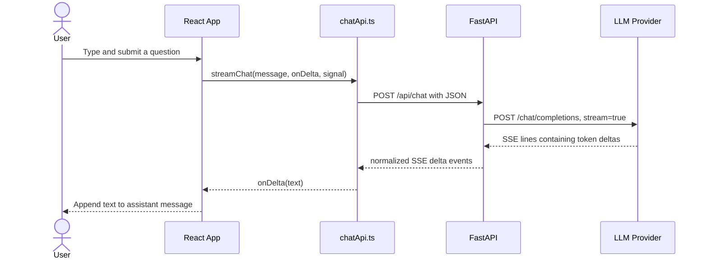

# Implementation Walkthrough: Foundation and AI Chat

This guide explains the current Milestone 1 implementation in source order. It describes what each statement or related block does and why it is there. No application code is changed by this guide.

## 1. The complete request lifecycle

The request body is a JSON object with the current message, for example `{"message":"Explain React useMemo"}`. The model key is not part of that request: only the backend has it.

## 2. Backend

### Application startup: [main.py](../backend/app/main.py)

- `from fastapi import FastAPI` imports the class used to create the HTTP application.
- `CORSMiddleware` is imported because the browser app and API run on different local origins during development. Browsers enforce cross-origin rules; this middleware tells them which origins and methods are allowed.
- The chat router and `get_settings` are imported from their own modules. This keeps route handling and configuration out of the application entry point.
- `settings = get_settings()` reads configuration once at startup.
- `app = FastAPI(...)` constructs the application and gives its generated API documentation a title and version.
- `app.add_middleware(...)` installs CORS handling. `allow_origins` comes from configuration rather than allowing every site. Credentials are disabled because this milestone uses no cookies or session authentication. Only `GET` and `POST` methods and the `Content-Type` header are allowed.
- `app.include_router(chat_router, prefix="/api")` mounts the router under `/api`. Since the route itself is `/chat`, the final endpoint is `POST /api/chat`.
- `@app.get("/health")` registers a simple health check. `health_check` returns a small JSON object and can confirm that the API process responds without using the LLM.

### Settings: [config.py](../backend/app/core/config.py)

- `lru_cache` is used to reuse one settings instance instead of rebuilding it whenever a route needs configuration.
- `BaseSettings` and `SettingsConfigDict` come from Pydantic Settings. They load values from environment variables and the configured `.env` file.
- `env_file=".env"` means the backend reads a `.env` in the process's working directory. Run Uvicorn from `backend/` as the README instructs so it finds `backend/.env`.
- `extra="ignore"` prevents unrelated environment variables from causing settings validation to fail.
- `llm_api_key`, `llm_base_url`, `llm_model`, and `cors_origins` define the configuration consumed by the service and CORS middleware. The key's empty default lets the API start without a key; the chat endpoint then returns a clear error.
- `allowed_origins` splits a comma-separated string, trims spaces, and removes empty entries. This turns a simple environment setting into the list expected by CORS middleware.
- `@lru_cache` on `get_settings` caches the result. Environment changes therefore require restarting the backend.

### Request validation: [chat.py](../backend/app/schemas/chat.py)

- `BaseModel` defines a Pydantic request schema, and `Field` adds validation constraints.
- `ChatRequest.message` must be a string from 1 to 12,000 characters. FastAPI uses this model to parse and validate incoming JSON before calling the endpoint.
- `@field_validator("message")` adds a rule beyond length: the text is trimmed and whitespace-only messages are rejected.
- Raising `ValueError` tells Pydantic validation failed; FastAPI returns HTTP `422` with validation details.

### Chat route and SSE response: [routes/chat.py](../backend/app/api/routes/chat.py)

- `json` serializes our event payloads; `logging` records backend diagnostics; `AsyncIterator` documents the asynchronous generator's output type.
- FastAPI's `APIRouter` keeps the endpoint modular. `HTTPException` represents an HTTP error before streaming begins. `StreamingResponse` sends a response body incrementally.
- The router, logger, settings loader, request model, and LLM service are imported from their owning modules.
- `encode_event(event_type, **data)` builds one SSE frame. `json.dumps` ensures values such as quotes and newlines in generated text are escaped correctly. The returned `data: ...\n\n` format means one event followed by a blank-line separator.
- `@router.post("/chat")` registers the POST endpoint. The `ChatRequest` annotation tells FastAPI to validate the request body.
- The endpoint retrieves configuration. If the API key is empty, it raises HTTP `503` before starting a stream; the frontend can still read this as an ordinary JSON error response.
- `event_stream` is an async generator. `async for` consumes provider tokens as they arrive, and each `yield` sends a normalized `delta` event to the browser. When the provider ends normally, it yields `done`.
- If the LLM service raises `LLMProviderError`, the exception details go to backend logs, while the browser receives a generic `error` event. This avoids exposing provider response bodies or secrets.
- `StreamingResponse` wraps the generator with `text/event-stream`. `Cache-Control: no-cache` discourages caching, and `X-Accel-Buffering: no` asks Nginx not to hold chunks before forwarding them.
- A failure that happens after streaming has started is represented as an SSE `error` event; HTTP status may already be `200`. A missing key is detected earlier and returns `503`.

### LLM provider adapter: [llm.py](../backend/app/services/llm.py)

- `json` parses the provider's JSON event data. `AsyncIterator` describes a function that asynchronously yields text pieces. `httpx` supplies the async HTTP client.
- `Settings` is passed in explicitly, so the service does not secretly read global configuration and can be tested with substitute settings.
- `LLMProviderError` gives provider/network problems one application-level exception type.
- `stream_completion(message, settings)` constructs a generator of text strings.
- `rstrip('/')` prevents a duplicate slash when joining the configured API root and `/chat/completions`.
- The `Authorization` header contains the secret key. This code runs on the server; the frontend never receives this header or key.
- The payload contains the configured model, `stream: true`, a fixed software-developer system instruction, and the current user message.
- The timeout gives connection establishment 10 seconds, reading 120 seconds, writing 30 seconds, and waiting for a connection-pool slot 10 seconds. This prevents a request from waiting forever.
- `AsyncClient` is used as an async context manager so the connection is closed reliably. `client.stream(...)` avoids buffering the entire response before reading it.
- `response.is_success` checks the provider's HTTP status. A non-success status becomes `LLMProviderError`.
- The line loop reads provider SSE output. Non-`data:` lines are ignored; `[DONE]` signals the provider has finished; empty payloads are skipped.
- Each data payload is parsed as JSON. Malformed JSON is ignored so a single unusable event does not crash the whole stream.
- Provider chat-completion events normally put deltas in `choices[0].delta.content`. The code guards against missing choices and only yields nonempty string content.
- Existing `LLMProviderError` exceptions are re-raised unchanged. Other `httpx.HTTPError` failures are wrapped in a safe message, with the original exception chained for backend debugging.

### Backend tests: [test_chat.py](../backend/tests/test_chat.py)

- `TestClient` invokes the FastAPI app in-process, so tests do not need a listening server.
- The imports expose the route module for monkeypatching, the `Settings` type, and the application.
- The shared `client` sends test requests to the app.
- `test_chat_streams_normalized_events` defines `fake_stream_completion`, an async generator that yields two known pieces instead of making a paid network request.
- `monkeypatch.setattr` replaces settings and the LLM function only for the test. This makes the test deterministic and verifies that the route forwards the message and emits `delta` and `done` SSE events.
- The response assertions check HTTP success, the streaming content type, both pieces of text, and the final event.
- `test_chat_rejects_blank_message` verifies Pydantic rejects whitespace-only input with `422`.
- `test_chat_reports_missing_provider_key` replaces settings with an empty key and verifies the route responds with `503` and a helpful detail.

## 3. Frontend

### Event and message types: [chat.ts](../frontend/src/types/chat.ts)

- `ChatRole` restricts message roles to the two roles currently rendered.
- `ChatMessage` defines the UI's message ID, role, and text. A stable ID lets React update one assistant message as tokens arrive.
- `DeltaEvent`, `DoneEvent`, and `ErrorEvent` describe the three server event shapes.
- `ChatStreamEvent` is a discriminated union. Checking `event.type` lets TypeScript determine which fields are valid.

### HTTP and stream parser: [chatApi.ts](../frontend/src/services/chatApi.ts)

- `import type` imports a TypeScript type without adding a runtime JavaScript import.
- `apiUrl` reads `VITE_API_URL`, falls back to localhost, and removes one trailing slash so the endpoint URL is joined predictably. Vite exposes `VITE_` variables to browser code, so this value must be public, never a secret.
- `readErrorMessage` accepts `unknown` because JSON error bodies are untrusted. It checks for an object with a string `detail`; otherwise it returns a safe fallback.
- `parseEvent(frame)` extracts all `data:` lines from one complete event frame, joins them, then parses JSON inside `try/catch`.
- The subsequent checks confirm the parsed value is a non-null object and has a `type`. Each event case is validated before a typed object is returned. Unknown shapes return `null` and are ignored.
- `streamChat` receives the user message, a callback for each text delta, and an `AbortSignal`. That keeps React out of the HTTP and SSE implementation.
- `fetch` sends `POST /api/chat`, marks the request body as JSON, asks for an SSE response, serializes `{ message }`, and attaches the abort signal.
- For HTTP errors, the service attempts to parse the JSON body and throws a useful `Error`. It separately checks that a response stream exists.
- `getReader()` exposes the response body as byte chunks. `TextDecoder` converts those bytes to text. `buffer` stores any partial SSE frame left at the end of a network chunk.
- `handleFrame` parses one frame, calls `onDelta` for text, and turns an `error` event into an exception. The `done` event is recognized but does not need special handling: the response body ending completes the loop.
- The read loop decodes each incoming chunk, normalizes CRLF newlines, finds frame boundaries, and processes each complete frame. It keeps the unfinished tail in `buffer` for the next chunk.
- At end-of-stream, a final nonempty buffer is processed. If reading or handling an event fails, the reader is cancelled and the error is rethrown to the component. `finally` releases the reader lock.

### Chat UI and state: [App.tsx](../frontend/src/App.tsx)

- React hooks manage component state, refs, and effects. `FormEvent` and `KeyboardEvent` make event handlers type-safe.
- `streamChat` is imported from the transport service, and `ChatMessage` provides the message shape.
- `prompts` is the set of suggested questions shown before the first message.
- `messages` stores visible chat turns; `draft` stores the textarea value; `loading` prevents overlapping submissions and controls the spinner; `error` stores a user-visible failure.
- `requestController` stores the current `AbortController`; `endOfMessages` points to a DOM element used for scrolling.
- The first effect scrolls the message end into view when messages or loading state change. The optional chain avoids errors before the ref is mounted.
- The cleanup effect aborts a request if the component unmounts, preventing a background network operation from continuing unnecessarily.
- `sendMessage` trims the draft and returns early for blank text or an active request.
- It creates a user message and an empty assistant placeholder, each with a unique `crypto.randomUUID()` ID. The assistant placeholder is how incoming pieces can be appended to a stable item.
- A new controller is saved, then both messages are appended with a functional state update. Functional updates use the latest state and avoid relying on a stale render value.
- The draft and old error are cleared, and loading starts before the network call.
- `streamChat` receives the text, a delta callback, and the abort signal. For every delta, the callback maps the current array and replaces only the assistant message with the matching ID, preserving all other messages.
- The catch block suppresses the expected abort error; other failures become visible in `error`. The `finally` guard checks that this request is still the active one before clearing its controller and loading state.
- `handleSubmit` prevents a full browser form submission and calls `sendMessage` with the current draft. `void` documents that the event handler intentionally does not await the promise.
- `handleComposerKeyDown` submits on Enter, while Shift+Enter keeps its usual multiline behavior.
- The JSX starts with a semantic `<main>` and `<header>`. Branding and milestone labels are presentational; `aria-label` and `aria-hidden` clarify how assistive technology should treat elements.
- The conversation region uses `aria-live="polite"` so screen readers can be notified of updates without interrupting aggressively.
- With no messages, the welcome view renders the suggested prompt buttons. Each button calls the same `sendMessage` function as the form, so there is one submission path.
- Otherwise, `messages.map` renders an article per message. The role controls its CSS class, avatar, and label. React uses the stable ID as the `key`.
- If an assistant message is empty while loading, the typing indicator appears; once the first text arrives, the content replaces it.
- The composer displays an alert banner when `error` is set. Its dismiss button clears that state.
- The textarea is controlled by React (`value` and `onChange`), capped at 12,000 characters to match backend validation, and disabled during the request.
- The send button is disabled when there is no non-whitespace draft or a request is active. It displays a spinner while loading.
- `export default App` lets the entry point import this component.

### React entry point: [main.tsx](../frontend/src/main.tsx)

- React and `createRoot` are imported to mount the component into the browser DOM.
- `App` and global CSS are imported.
- `createRoot(document.getElementById('root')!)` finds the root element declared by `index.html`. The `!` tells TypeScript it is known to exist; if the HTML omitted it, this would fail at runtime.
- `StrictMode` wraps the app in development checks. It does not add a visible UI feature.

### Styling: [styles.css](../frontend/src/styles.css)

- The first `@import` loads DM Sans, DM Mono, and Newsreader for UI text, technical labels, and editorial headings.
- `:root` sets global typography, foreground/background colors, rendering defaults, and reusable color/font variables.
- `box-sizing: border-box` makes declared element dimensions include their padding and border, which simplifies layout sizing.
- `body` sets minimum dimensions, removes browser default margin, and layers a subtle grid over the background.
- Buttons and textareas inherit typography. Buttons inherit the main text color.
- `.workspace` and `.topbar` establish the full-height shell and header grid; the brand, status, and profile classes style those individual header pieces.
- `.chat-layout` constrains the content width and uses a column flex layout so the conversation can grow while the composer remains at the bottom.
- `.conversation`, `.welcome`, and `.prompt-*` rules control the empty-state spacing and suggested prompt controls.
- `.message-*` rules lay out each avatar and message, distinguish user and assistant styles, preserve whitespace, and wrap long content.
- `.typing-indicator` styles three animated dots. `.composer-*` rules define the sticky input area, focus feedback, send button, and disabled/loading states.
- `.error-banner` gives failures a distinct visual treatment; `.sr-only` hides labels visually while keeping them available to screen readers.
- The `@keyframes` blocks define entrance, typing, and spinner motion. The mobile media query adjusts header, message, and composer sizing below 640px. The reduced-motion query minimizes animations for people who request less motion.

## 4. Build and environment files

- [package.json](../frontend/package.json) defines the frontend scripts. `npm run build` runs `tsc -b` before `vite build`, so type errors stop the production build. React and React DOM are runtime dependencies; Vite, TypeScript, the React plugin, and React type declarations are build-time dependencies.
- [tsconfig.json](../frontend/tsconfig.json) references separate app and Vite-config TypeScript projects.
- [tsconfig.app.json](../frontend/tsconfig.app.json) enables strict TypeScript checks, modern browser libraries, JSX transform, and unused-code errors. `types: ["vite/client"]` provides types for `import.meta.env`.
- [tsconfig.node.json](../frontend/tsconfig.node.json) applies strict checking to the Vite configuration file.
- [vite.config.ts](../frontend/vite.config.ts) installs the React plugin and binds the development server to `127.0.0.1`, making it local-only by default.
- [backend/.env.example](../backend/.env.example) documents the backend-only provider key, provider URL, model, and allowed frontend origins. Copy it to `.env` and replace the example key locally.
- [frontend/.env.example](../frontend/.env.example) contains only the public FastAPI URL. Variables prefixed `VITE_` are compiled into client code, so never put the LLM key there.
- [.gitignore](../.gitignore) keeps `.env` files, virtual environments, Python caches, Node dependencies, and build output out of version control, while allowing `.env.example` files to be committed.
- Backend `requirements.txt` lists FastAPI, HTTPX, Pydantic Settings, and Uvicorn. `requirements-dev.txt` includes those requirements plus pytest for tests.

## 5. Why this structure was chosen

- **The UI does not know provider details.** The backend owns the key and provider call; the frontend knows only the app's `/api/chat` contract.
- **The route and provider adapter are separate.** The route owns HTTP concerns, while `llm.py` owns the provider protocol. This makes either layer easier to test or replace.
- **The backend normalizes provider events.** The UI depends on `delta`, `done`, and `error`, not a particular vendor's JSON layout.
- **Streaming is implemented directly.** `httpx` and the browser `ReadableStream` expose the mechanics clearly for learning. No LLM framework hides the request/response flow.
- **Provider calls are asynchronous.** Async I/O lets the server wait for network chunks without blocking the event loop thread.
- **Errors are checked on both sides.** HTTP validation/configuration errors are ordinary JSON responses; failures after streaming begins are SSE error events.
- **The milestone deliberately has no persistence or retrieval.** This keeps the first learning goal to one request round trip.

## 6. Important current limitations

1. **The conversation history is not sent to the model.** `App.tsx` keeps previous turns on screen, but `streamChat` sends only the latest message. `llm.py` constructs a provider request with the system instruction and that one user message. The model therefore cannot refer back to prior turns yet.
2. **Messages are not persisted.** Refreshing the browser clears the chat.
3. **The frontend recognizes `done` but does not require it.** End-of-stream is treated as completion. A network failure that ends cleanly but omits `done` could leave a partial answer without a distinct incomplete-stream warning.
4. **The provider parser assumes an OpenAI-compatible chat-completions SSE shape.** A provider with a different event format needs an adapter change.
5. **This is a learning foundation, not a complete production deployment.** There is no authentication, rate limiting, usage tracking, retry policy, background queue, or operational monitoring yet.

## 7. Trace the request yourself

A useful debugging exercise is to set breakpoints or add temporary logs in this order:

1. `sendMessage` in `App.tsx`: inspect the trimmed message and the two message objects.
2. `streamChat` in `chatApi.ts`: inspect the outgoing URL, headers, and JSON body.
3. `chat` in the backend route: inspect the validated `ChatRequest` and settings presence (never print the key itself).
4. `stream_completion` in `llm.py`: inspect the URL, model, and message payload. Do not log the authorization header.
5. The provider line loop: inspect one provider event and the extracted `content` delta.
6. `encode_event`: inspect the normalized SSE text.
7. `parseEvent` and `handleFrame` in the frontend service: inspect the event type and content.
8. The `onDelta` callback in `App.tsx`: watch the assistant message grow token by token.
